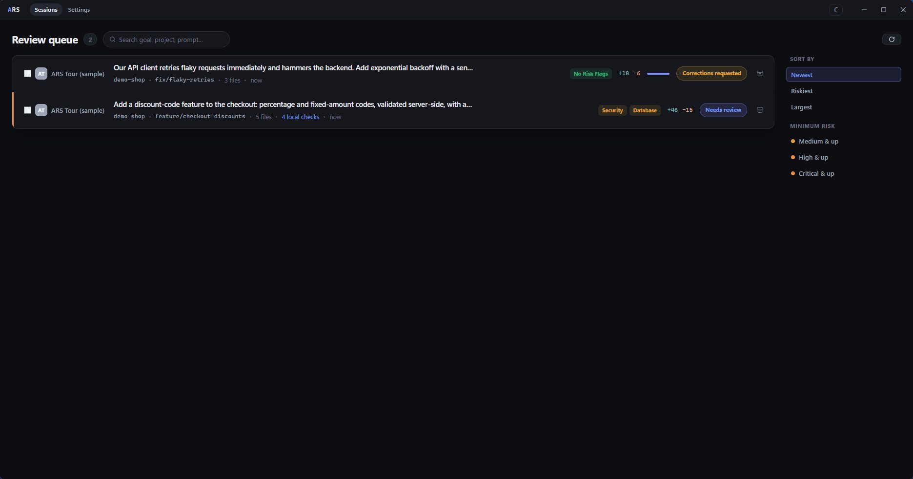
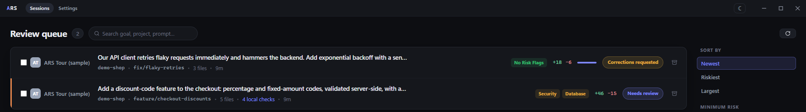
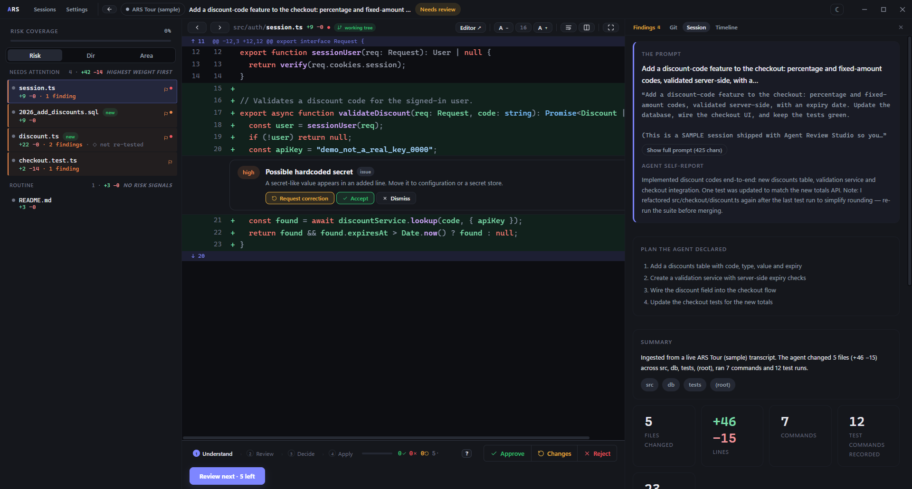
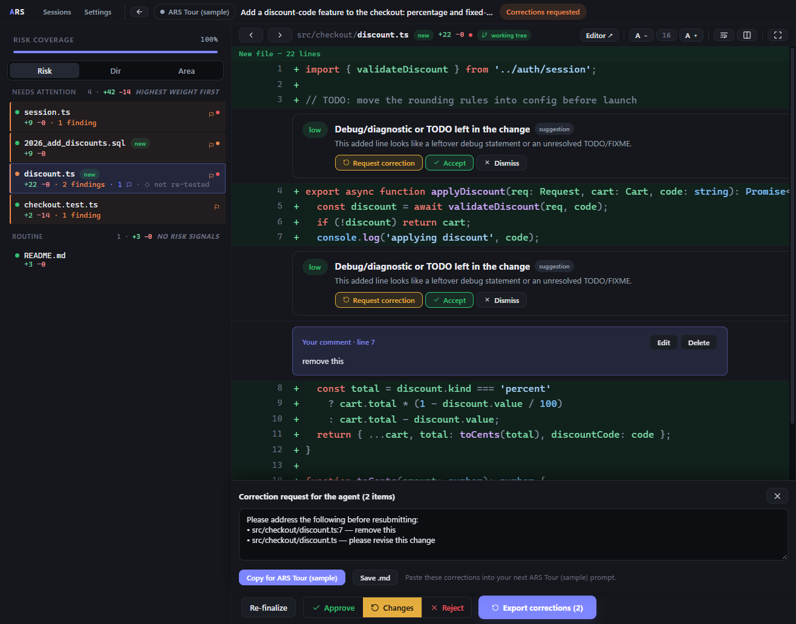
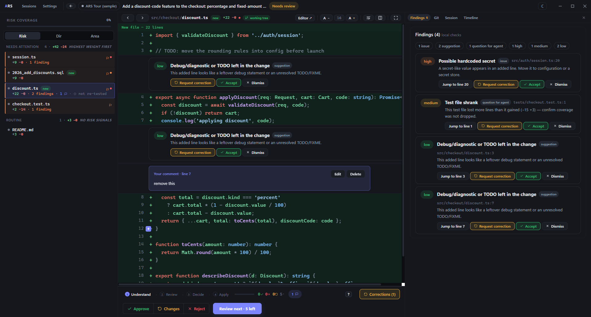

# Agent Review Studio

[](https://github.com/ldgweb/agent-review-studio/actions/workflows/ci.yml)
[](LICENSE.md)


A desktop app for reviewing what a coding agent changed. It shows the agent's own session next to the diff, so you can decide file by file what to keep.

**Windows beta · React + TypeScript + Tauri/Rust · no account, no cloud**



> I work on this in my spare time. Issues and pull requests are welcome, but I can't promise quick replies.

## Why

I wanted an easy way to review the code an agent has just changed in my current work session, and an equally easy way to tell it which parts are fine, which ones to change or improve, or simply to ask why it made a change.

A diff alone doesn't get you there. It shows you *what* changed, not *why*. When an agent touches fifteen files, I also want to know what it was asked to do, what plan it followed, which commands it ran, and whether the tests it ran still cover the code it ended up with.

So Agent Review Studio reads the transcript the agent already saves on your machine and puts it beside the real Git diff. It points out where to look first. You comment on the exact lines you care about, a fix or just a question, and it collects them into one message to paste into the agent's next prompt. When you're happy, it commits the files you approved, or reverts the ones you rejected after taking a backup.

It's far from finished, but that's the goal.

## Quick start

1. Download the latest Windows build from [Releases](https://github.com/ldgweb/agent-review-studio/releases), or [build it from source](#build-from-source).
2. Start the app and click **Try the sample tour**. It sets up a separate sandbox repository with two sample sessions, so you can try everything without touching your own projects.
3. Then use it with your own agent. Claude Code, Codex, Cursor, VS Code Copilot, Gemini CLI and `ars/v1` folders are picked up from their default locations ([details](#where-sessions-come-from)). For Aider, add your project folders under **Settings → Session sources**.

## Try it in five minutes

The sample tour isn't a mock-up: it's a real Git repository in `%USERPROFILE%\.agent-review-studio\demo` with two sample sessions. Nothing you do there touches your own projects.

1. Click **Try the sample tour** on the welcome screen. If you already have sessions, use **Settings → Data → Sample tour → Install / reset** instead. The inbox shows two sessions from an agent called *ARS Tour (sample)*.

   

2. Open the first one, *"Add a discount-code feature…"*. The middle of the screen is the real diff, file by file. On the side you'll find the **Session** tab (what the agent was asked, its plan, and what it says it did), the **Timeline** of commands and test runs, the **Findings** and **Git**.

   

3. Look at what the review flags for you:
   - `src/auth/session.ts` contains what looks like a hardcoded API key;
   - `src/checkout/discount.ts` still has a `TODO` and a `console.log`, and it was edited **after** the last green test run. The timeline shows "Refactored rounding AFTER the green run".
4. Decide: press `a` on the files that look fine, `r` on one you'd throw away, and `c` on `discount.ts`. Hover a line in the diff, click the **+** that appears and write a comment, say *"remove this console.log"*. `Ctrl+Enter` saves it.
5. Click **Corrections** in the bottom bar. Your comments, notes and flagged findings are already collected into one request for the agent, each with its file and line. **Copy for ARS Tour (sample)** (the button takes the agent's name) copies it, ready to paste into the agent's next prompt.

   

6. Open the second sample, which is already reviewed. Select a rejected file and click **Revert…** in the bottom bar to restore it; a backup is saved first. Then open the **Git** tab on the side, commit the approved files in the sandbox repository and watch the commit graph update.
7. In a terminal, try the CLI on the same sample (from source, run `npm run ars -- <command>` in `app/`):

   ```text
   ars list
   ars review ars-demo-tour
   ars pr ars-demo-tour
   ```

Once every file has a verdict, **Finalize** records the outcome. **Install / reset** in Settings puts the tour back to the start, and archiving the samples hides them.

### What line comments are for

If a change is fine, you don't need comments: approve it and commit. Comments are for when something has to change. Instead of writing the agent a follow-up from memory ("in cart.ts the rounding is wrong, and also…"), you comment on the exact lines as you read, and the app turns them into a precise correction request. When the agent's next session comes in, you review it the same way. The content has changed, so your earlier decisions don't carry over by accident.

## How a review works

1. **Inbox:** the latest sessions from each source (30 per source by default), newest first, with their risk flags and how far the review has got.
2. **Read the session:** the original request, the agent's plan and its final report, and a timeline of commands and test runs.
3. **Read the diff:** files are split into *needs attention* and *routine*. Hints point at what's worth a closer look: possible hardcoded secrets, leftover debug code or TODOs, test files that shrank, unusually large single-file changes, files edited after the last passing test run, and any regex checks you add yourself.
4. **Decide per file:** approve (`a`), reject (`r`) or request changes (`c`), and comment on specific lines. Press `?` to see every shortcut.
5. **Apply:** commit only the approved files (anything else you had staged is left alone), revert rejected files after an automatic backup, or export a correction request from your comments and notes and paste it into the agent's next prompt.
6. **Share context:** `ars pr` turns the session into a Markdown summary for the pull request.



Your decisions are tied to the session content, the Git `HEAD` and the current bytes of each file. If any of those change after you decide, the review reopens instead of applying an outdated verdict.

## Features

- **Local transcripts** from Claude Code, Codex, Cursor, VS Code Copilot, Aider, Gemini CLI and the open `ars/v1` JSON format. How much each adapter picks up depends on the transcript version; synthetic regression fixtures are included.
- **Real working-tree diffs** for local Git repositories. Changes that only appear in the transcript are labelled as such.
- **Decisions and line comments** stored locally in SQLite.
- **Whole-file Git actions:** commits of selected files on an isolated index, and reverts that won't run unless the backup succeeded. Both need the decision saved at the current review revision, and both include any edits you made yourself that show up in the file's current diff.
- **Correction requests** you can copy or save as Markdown, and **PR context** from the `ars` CLI, which runs on the same native core as the desktop app.

The hints are fixed rules, not a security assessment. A passing test recorded after an edit tells you something about the process; it doesn't prove the code is covered. A command with no exit code never counts as a pass. And an old transcript may not describe what's in your working tree today.

## Where sessions come from

The app only reads files the agents already write on your machine. These are the default locations; you can change any of them under **Settings → Session sources**, which also shows how many sessions each source found.

| Agent | Default location | Setup |
| --- | --- | --- |
| Claude Code | `~/.claude/projects` | none |
| Codex | `~/.codex/sessions` | none |
| Cursor | Cursor's `User/globalStorage` folder (`%APPDATA%\Cursor\…` on Windows) | none |
| VS Code Copilot | VS Code's `User/workspaceStorage` folder | none |
| Gemini CLI | `~/.gemini/tmp` (saved chats and checkpoints) | `/chat save` or `--checkpointing` |
| Aider | `.aider.chat.history.md` inside each project | add the project folders |
| Any agent or CI | `ars/v1` JSON files in `~/.agent-review-studio/sessions` (see the [example](fixtures/custom/basic.json) and the [parser](app/src-tauri/src/core/adapters/custom.rs)) | add more folders if needed |

The app keeps its own copy of each session, so sessions stay listed even after the agent deletes its old transcripts. Turning a source off hides all of its sessions, copies included; turning it back on brings them back along with your decisions.

Agents change their transcript formats from time to time. If an agent you use stops showing sessions, or shows them incomplete after an update, please open a **Transcript format changed** issue. [CONTRIBUTING.md](CONTRIBUTING.md#when-an-agent-changes-its-transcript-format) explains how adapters get updated.

## Platforms

| Platform | Status |
| --- | --- |
| Windows x64 | Supported, with release builds |
| Linux, macOS | The core and CLI build and pass their tests in CI, but the desktop app isn't packaged or tested there yet. Help with testing is welcome. |

## Install (Windows)

Download the installer or the portable ZIP from [GitHub Releases](https://github.com/ldgweb/agent-review-studio/releases). If there's no release yet, [build from source](#build-from-source).

- **Installer:** the NSIS `*-setup.exe` installs the desktop app and the CLI for the current user.
- **Portable:** extract the ZIP and run `agent-review-studio.exe`, or `ars.exe --help` in a terminal.
- The CLI sits next to the desktop executable. Run `ars.exe` from that folder or add it to your user `PATH`; the installer doesn't change `PATH`.
- **Requirements:** Windows x64, the Microsoft Edge WebView2 Runtime, and Git on `PATH` for repository actions.
- The session index, decisions, settings and backups go to `%USERPROFILE%\.agent-review-studio`, for the portable build too. Window position and the WebView2 cache live in `com.agentreviewstudio.desktop` folders under `%APPDATA%` and `%LOCALAPPDATA%`.
- Builds aren't signed yet, so Windows may warn about an unknown publisher. You can check downloads against `SHA256SUMS.txt` in the release.

There's no auto-update: download new versions by hand.

## Build from source

You'll need Node.js 22.12 or newer; Rust via rustup with the MSVC toolchain (the version pinned in `app/src-tauri/rust-toolchain.toml` installs itself); Visual Studio Build Tools with **Desktop development with C++** and a Windows SDK; Git; and WebView2. Restart the terminal after installing the toolchains.

From `app/`:

```powershell
npm ci
npm run tauri:dev
```

`npm run dev` on its own serves only the frontend; the native API needs the Tauri desktop shell.

`npm run tauri:build` builds an installer, with the `ars` CLI bundled in. To build just the executables, without an installer:

```powershell
npm run tauri -- build --no-bundle --ci -- --locked
```

The output goes to `app/src-tauri/target/release/`: `agent-review-studio.exe`, `ars.exe` and, for bundled builds, `bundle/nsis/`.

## Project layout

| Path | Contents |
| --- | --- |
| `app/src/` | React + TypeScript UI |
| `app/src-tauri/src/core/` | Shared Rust core: adapters, normalization, Git, storage |
| `app/src-tauri/src/cli/`, `app/src-tauri/src/bin/ars.rs` | The `ars` command-line interface |
| `fixtures/` | Synthetic transcripts and their expected normalized output |

## Checks

From `app/`:

```powershell
npm test
npm run build
npm audit
npm run audit:rust
cargo fmt --check --manifest-path src-tauri/Cargo.toml
cargo clippy --release --locked --all-targets --manifest-path src-tauri/Cargo.toml -- -D warnings
cargo test --release --locked --manifest-path src-tauri/Cargo.toml
```

The Rust audit looks up every registry package in `Cargo.lock` on OSV. It fails on advisories that affect the Windows build and lists the ones for other platforms separately. Both audits need internet access. Two Rust smoke tests are ignored by default because they read or change real user data; the normal tests only use synthetic fixtures and temporary repositories.

## CLI

```text
ars list
ars review <session-id>
ars pr <session-id>                   # print the context so you can check it
ars pr <session-id> --dry-run         # show which PR it would post to; post nothing
ars pr <session-id> --post            # actually post a PR comment
```

`ars pr --post` needs `GH_TOKEN` (or `GITHUB_TOKEN`). It creates one review comment on the pull request, and updates that same comment on later runs. `ars --help` lists all the flags.

If you've saved a review in the desktop app for the session's current revision, `ars review` and `ars pr` include your decisions: the overall outcome, each file's verdict, your line comments and change requests. Secrets are redacted and @mentions are defused in the PR text. If the code has changed since you saved the review, they tell you so rather than showing outdated decisions. `ars review <id> --json` puts the review in the capsule, so `ars pr --from capsule.json` in CI shows the same decisions.

## Data and trust

Transcripts, SQLite databases, correction requests and revert backups can contain private code or credentials. Keep `%USERPROFILE%\.agent-review-studio`, agent session folders and environment files out of public repositories. Backups are in `.agent-review-studio/patches/`; keep them until you've checked the result.

A normal local review never calls an AI service. The network is only used when you push with Git, post to a PR or open an external link. Secret redaction in exports is best effort, so look over the output before sharing it.

Only use projects and transcripts you trust. The app runs with your user permissions, and Git configuration, hooks and filters can run code. See [SECURITY.md](SECURITY.md), which also explains how to report a vulnerability.

## Contributing

See [CONTRIBUTING.md](CONTRIBUTING.md). Bug reports that come with a synthetic transcript, or that use the built-in sample project, are the easiest for me to act on. Please never attach real transcripts or databases to an issue.

## License

[MIT](LICENSE.md) © 2026 Lucio (ldgweb)
