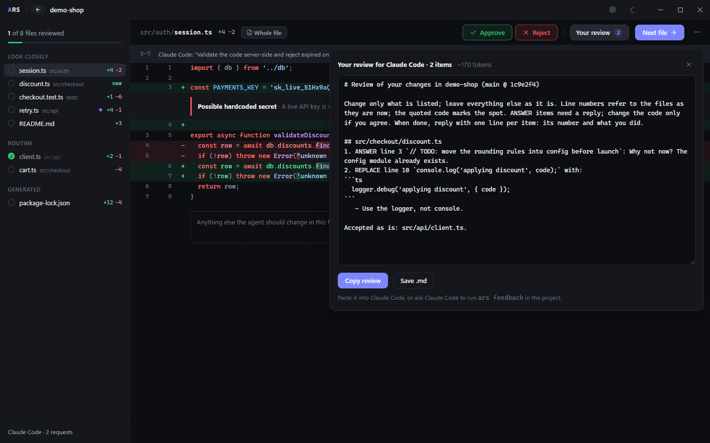
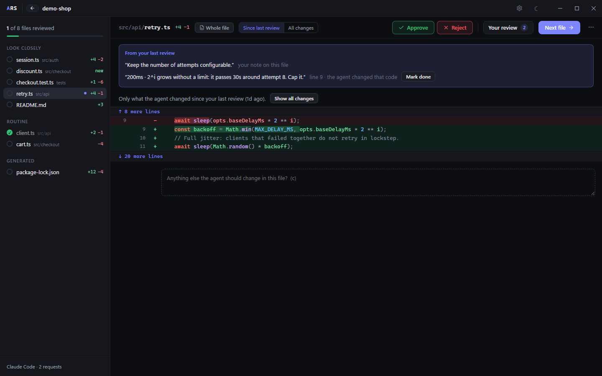

# Agent Review Studio

[](https://github.com/ldgweb/agent-review-studio/actions/workflows/ci.yml)
[](LICENSE.md)


A desktop app for reviewing what a coding agent changed in your project, before you commit. Above every change it shows why the agent made it. You decide what to keep, and your decisions become a review the agent can act on.

**Windows beta · React + TypeScript + Tauri/Rust · no account, no cloud**


> I work on this in my spare time. Issues and pull requests are welcome, but I can't promise quick replies.

## Why

I wanted an easy way to review the code an agent has just changed in my current work session, and an equally easy way to tell it which parts are fine, which ones to change or improve, or simply to ask why it made a change.

A diff alone doesn't get you there. It shows you *what* changed, not *why*. And an editor shows every line with the same weight, even when half of the change is a moved function or a reformatted block.

So Agent Review Studio starts from Git, like your editor does: the review is everything uncommitted in the project, whoever or whatever changed it. Then it reads the transcripts the agents already save on your machine. Above every changed block it shows the request it came from and what the agent said right before making it. Blocks that no recorded agent edit explains (a shell command, a script, a change by hand) say so. You decide change by change, comment on the exact lines or write the code you want instead. **Copy review** then gives the agent all of it in one text. The next time, you only look at what changed since.

It never touches your code. Even a rejection is an instruction for the agent, not an edit by the app.

It's far from finished, but that's the goal.

## Quick start

1. Download the latest Windows build from [Releases](https://github.com/ldgweb/agent-review-studio/releases), or [build it from source](#build-from-source).
2. Start the app and click **Try the sample tour**. It sets up a separate sandbox repository with two sample sessions, so you can try everything without touching your own projects.
3. Then use it with your own agent. Claude Code, Codex, Cursor, VS Code Copilot, Gemini CLI and `ars/v1` folders are picked up from their default locations ([details](#where-sessions-come-from)). For Aider, add your project folders under **Settings → Session sources**.
4. While you work, run `ars .` in the project folder (any subfolder works). The app opens, or comes to the front, on that project's review. The installer doesn't add `ars` to your `PATH`; see [Install](#install-windows).

## The everyday loop

```text
ars .           # the agent just finished: open what it changed
a / r           # approve or reject the file; c writes a note about it
⇧A ⇧R  ⇧C       # approve, reject or comment on one change; [ and ] move between changes
Copy review     # copy it for the agent: every verdict becomes an instruction
```

Paste it into the agent's next prompt. Or let the agent fetch it: ask it to run `ars feedback` in the project, and it gets the same text straight in its session. That works with any agent that can run a command (Claude Code, Codex, Cursor's agent, Gemini CLI, Aider). In Claude Code you can make it a command once. Save a file `~/.claude/commands/review.md` that says *Run `ars feedback` in this project and carry out every numbered item; then reply with one line per item.* Then type `/review`.

The review is written for the agent to act on with as few tokens as possible. There is one numbered item per thing to do, grouped by file. Each item starts with a verb and points at the line by its number and the quoted code. Code is spelled out only where the agent can't know it: what to put back, or what you want instead.

````text
# Review of your changes in shop (main @ 3f2a9c1)

Change only what is listed; leave everything else as it is. Line numbers refer to the files as they are now; the quoted code marks the spot. ANSWER items need a reply; change the code only if you agree. When done, reply with one line per item: its number and what you did.

## src/cart.ts
1. CHANGE line 12 `console.log(total)`: drop the log
2. REPLACE line 30 `const limit = 10` with:
```ts
const limit = MAX_ITEMS
```
3. UNDO lines 50–51 `retryAll()`: remove the lines you added.
4. ANSWER line 64 `cache.clear()`: why not reuse the store?

## src/legacy.ts
5. RESTORE this file you deleted: `git checkout HEAD -- src/legacy.ts`

Accepted as is: src/api.ts, docs/cart.md.
````



The verbs are CHANGE, REPLACE and REMOVE (from your comments and suggested code), ANSWER (a comment that ends with a question mark), UNDO, DELETE and RESTORE (from rejections) and FIX (a hint you pass on). Comments from your last review that the agent left untouched come back, marked as still open.

When the agent is done, run `ars .` again. Changed files open on **Since last review**: the diff of just what the agent did after your review. Every verdict on code that didn't change is still there.



## Try it in five minutes

The sample tour isn't a mock-up: it's a real Git repository in `%USERPROFILE%\.agent-review-studio\demo\demo-shop` with two sample sessions. Nothing you do there touches your own projects.

1. Click **Try the sample tour** on the welcome screen (or **Settings → Data → Sample tour → Install / reset**). The review of the sandbox project opens.
2. Every block of changes has a line on top with the sample agent's reason for it. Click the reason to read your request and the agent's words in full, right there. The agent's whole session (your requests, its report, what it ran) opens from the bottom of the file list.
3. Look at what the review flags for you:
   - `src/auth/session.ts` contains what looks like a hardcoded API key;
   - `src/checkout/discount.ts` still has a `TODO` and a `console.log`, and it was edited **after** the last green test run.
4. Decide: press `a` on the files that look fine and `r` on one you'd throw away. In `discount.ts`, hover a line and click the speech bubble in the margin to write a comment, say *"remove this console.log"*. Or click the pencil next to it to suggest code: write the line as you want it. The suggestion shows up in the diff, under the line it replaces. `Ctrl+Enter` saves. A comment marks its change as "change requested". The ✓ / ✕ on a block decide just that change.
5. The retry files come from a second sample you **already reviewed once**: `src/api/client.ts` is still approved, and `src/api/retry.ts` opens on **Since last review**, which shows only the cap the agent added after your comment. Your comment from that round sits above the diff, saying whether the agent changed its code.
6. When every file has a verdict, click **Copy review**. It is copied, ready to paste: what you rejected is in it as UNDO or DELETE, for the agent to carry out. **Your review** shows it, and lets you edit it, at any point. The sandbox's files stay exactly as they were.
7. In PowerShell, try the CLI on the same project (from source, run `npm run ars -- <command>` in `app/`):

   ```powershell
   ars review "$env:USERPROFILE\.agent-review-studio\demo\demo-shop"
   ars pr "$env:USERPROFILE\.agent-review-studio\demo\demo-shop"
   ```

**Install / reset** in Settings puts the tour back to the start.

### What line comments are for

If a change is fine, you don't need comments: approve it. Comments are for when something has to change. Instead of writing the agent a follow-up from memory ("in cart.ts the rounding is wrong, and also…"), you comment on the exact lines as you read, and the app turns them into precise items for the agent. A comment sits on its change. When the agent rewrites that code, the next review shows the comment above the file, marked "the agent changed that code", and the review for the agent stops repeating it.

## How a review works

1. **Open:** `ars .`, or a project on the home screen. The review is every uncommitted change of the Git repository: staged or not, plus new files.
2. **Read the why:** above each block, the agent's words before the edit (click them for your request too), or "No recorded agent edit" with the command that named the file, when there was one.
3. **Read less:** moved code, whitespace-only changes and generated files (lockfiles, minified bundles, what `.gitattributes` marks `linguist-generated` or `-diff`) are folded; the same change repeated in many places can be approved once. The file list puts first what deserves a closer look; hints under the code point at possible hardcoded secrets, leftover debug code or TODOs, test files that shrank, large single-file changes, files edited after the last passing test run, and any regex checks you add yourself.
4. **Decide:** per file (`a` / `r`, or the buttons above the code) or per change (`⇧A` / `⇧R`, or ✓ / ✕ on the block). Comment on a line, or suggest the code you want instead; a note at the end of the file covers the rest. Press `?` to see every shortcut.
5. **Copy review:** copy it (or save it as Markdown) and paste it into the agent's next prompt, or let the agent run `ars feedback`. Copying records a round: a snapshot of every changed file, the base of "since last review". Your files are not touched; commit with your own Git tools.
6. **Share context:** `ars pr` turns the review into a Markdown summary for the pull request.

Your decisions are tied to the code you saw, not to a session. A verdict on a change holds while that exact change exists, wherever it moves in the file. A verdict on a file without changes to show (a binary, a mode change) holds while its bytes and `HEAD` are the same. When something changes, only the decisions on what changed are gone.

## Features

- **Git first:** every uncommitted change, including the ones an agent made through a shell command or a script, which a transcript-based list would miss.
- **The why of every change**, matched line by line against the edits recorded in Claude Code, Codex and `ars/v1` transcripts (other agents give file-level context). The counts are what they are, "8 of 10 lines", never a score.
- **Since last review**, with comments that know whether their code changed.
- **A diff that reads like your editor:** syntax colors from the whole file (a block comment stays a comment across lines), every changed word marked, removed and added lines paired by similarity so an inserted line doesn't shift the rest, moved code linked to where it came from, unified or side by side, context that expands from the file. **Whole file** (`f`) shows the entire file at once, colored, with the changes marked; your editor (VS Code, Cursor or Windsurf) is one click away. Right-click a file in the list to show it in File Explorer or copy its path.
- **Change-level verdicts, and instructions instead of edits:** a rejected block becomes an UNDO with exactly what to remove or put back; a comment can carry the code you want instead (like a GitHub suggested change). Nothing in the project is ever written by the app.
- **Fast:** the app reads only the open project's transcripts, and only the lines added since its last read; it refreshes when files change, never on a timer.
- **PR context** from the `ars` CLI, which runs on the same native core as the desktop app.

The hints are fixed rules, not a security assessment. A passing test recorded after an edit tells you something about the process; it doesn't prove the code is covered. A command with no exit code never counts as a pass.

## Where sessions come from

The app only reads files the agents already write on your machine. These are the default locations; you can change any of them under **Settings → Session sources**, which also shows how many sessions each source found.

| Agent | Default location | Setup |
| --- | --- | --- |
| Claude Code | `~/.claude/projects` | none |
| Codex | `~/.codex/sessions` | none |
| Cursor | Cursor's `User/globalStorage` folder (`%APPDATA%\Cursor\…` on Windows) | none |
| VS Code Copilot | VS Code's `User/workspaceStorage` folder | none |
| Gemini CLI | `~/.gemini/tmp` (saved chats and checkpoints) | `/chat save` or `--checkpointing` |
| Aider | `.aider.chat.history.md` inside each project | add the project folders |
| Any agent or CI | `ars/v1` JSON files in `~/.agent-review-studio/sessions` (see the [example](fixtures/custom/basic.json) and the [parser](app/src-tauri/src/core/adapters/custom.rs)) | add more folders if needed |

The app keeps its own copy of each session, so sessions stay listed even after the agent deletes its old transcripts. Turning a source off hides its sessions, and its edits no longer explain changes in a review; the review says so when that is why a change has no explanation.

Agents change their transcript formats from time to time. If an agent you use stops showing sessions, or shows them incomplete after an update, please open a **Transcript format changed** issue. [CONTRIBUTING.md](CONTRIBUTING.md#when-an-agent-changes-its-transcript-format) explains how adapters get updated.

## Platforms

| Platform | Status |
| --- | --- |
| Windows x64 | Supported, with release builds |
| Linux, macOS | The core and CLI build and pass their tests in CI, but the desktop app isn't packaged or tested there yet. Help with testing is welcome. |

## Install (Windows)

Download the installer or the portable ZIP from [GitHub Releases](https://github.com/ldgweb/agent-review-studio/releases). If there's no release yet, [build from source](#build-from-source).

- **Installer:** the NSIS `*-setup.exe` installs the desktop app and the CLI for the current user.
- **Portable:** extract the ZIP and run `agent-review-studio.exe`, or `ars.exe --help` in a terminal.
- The CLI sits next to the desktop executable, and `ars .` starts the `agent-review-studio.exe` beside it. The installer doesn't change `PATH`; to run `ars` from any terminal, add the install folder to your user `PATH` once (PowerShell, then open a new terminal):

  ```powershell
  [Environment]::SetEnvironmentVariable('Path', [Environment]::GetEnvironmentVariable('Path', 'User') + ";$env:LOCALAPPDATA\Agent Review Studio", 'User')
  ```

  For the portable build, use the folder you extracted it to.
- **Requirements:** Windows x64, the Microsoft Edge WebView2 Runtime, and Git on `PATH` (the review reads the changes from it).
- The session index, decisions, settings and the file snapshots of each review round go to `%USERPROFILE%\.agent-review-studio`, for the portable build too. Window position and the WebView2 cache live in `com.agentreviewstudio.desktop` folders under `%APPDATA%` and `%LOCALAPPDATA%`.
- Builds aren't signed yet, so Windows may warn about an unknown publisher. You can check downloads against `SHA256SUMS.txt` in the release.

There's no auto-update: download new versions by hand.

## Build from source

You'll need Node.js 22.12 or newer; Rust via rustup with the MSVC toolchain (the version pinned in `app/src-tauri/rust-toolchain.toml` installs itself); Visual Studio Build Tools with **Desktop development with C++** and a Windows SDK; Git; and WebView2. Restart the terminal after installing the toolchains.

From `app/`:

```powershell
npm ci
npm run tauri:dev
```

`npm run dev` on its own serves only the frontend; the native API needs the Tauri desktop shell.

`npm run tauri:build` builds an installer, with the `ars` CLI bundled in. To build just the executables, without an installer:

```powershell
npm run tauri -- build --no-bundle --ci -- --locked
```

The output goes to `app/src-tauri/target/release/`: `agent-review-studio.exe`, `ars.exe` and, for bundled builds, `bundle/nsis/`.

## Project layout

| Path | Contents |
| --- | --- |
| `app/src/` | React + TypeScript UI |
| `app/src-tauri/src/core/` | Shared Rust core: adapters, normalization, Git, storage |
| `app/src-tauri/src/cli/`, `app/src-tauri/src/bin/ars.rs` | The `ars` command-line interface |
| `fixtures/` | Synthetic transcripts and their expected normalized output |

## Checks

From `app/`:

```powershell
npm test
npm run build
npm audit
npm run audit:rust
cargo fmt --check --manifest-path src-tauri/Cargo.toml
cargo clippy --release --locked --all-targets --manifest-path src-tauri/Cargo.toml -- -D warnings
cargo test --release --locked --manifest-path src-tauri/Cargo.toml
```

The Rust audit looks up every registry package in `Cargo.lock` on OSV. It fails only on a vulnerability in a package the Windows build ships, unless `app/scripts/audit-allowlist.json` says why it doesn't affect the app. Informational advisories (unmaintained, unsound) and packages that only other platforms use are listed but don't fail it. Both audits need internet access. Three Rust smoke tests are ignored by default because they read or change real user data; the normal tests only use synthetic fixtures and temporary repositories.

## CLI

```text
ars .                       # open this project's review in the app
ars open [dir]              # the same, for another folder
ars list                    # recent agent sessions
ars review [dir]            # the review in the terminal: who wrote what, your verdicts, findings, comments
ars feedback [dir]          # for the agent: print the review as instructions, start the next round
ars pr [dir]                # the review as a Markdown summary for the pull request
ars pr [dir] --dry-run      # show which PR it would post to; post nothing
ars pr [dir] --post         # actually post a PR comment
```

`feedback` prints exactly what **Copy review** copies in the app (your edited text, if you edited it) and records the round the same way. When you have not asked for anything yet, it says so and records nothing. The agent needs `ars` on its `PATH` (see [Install](#install-windows)).

`review` and `pr` take a folder of the project (the current one by default) or a session id from `ars list` (that session's project). `ars pr --post` needs `GH_TOKEN` (or `GITHUB_TOKEN`). It creates one review comment on the pull request, and updates that same comment on later runs. `ars --help` lists all the flags.

Both include your decisions from the desktop app: the outcome they add up to, each file's verdict, your open comments, and how many review rounds there were. Secrets are redacted and @mentions are defused in the PR text.

`ars review --json > review.json` saves the whole review. Then `ars pr --from review.json` in CI shows the same thing where the transcripts aren't available. That file is not redacted, so don't share it.

## Data and trust

Transcripts, the app's SQLite database (with the file snapshots of each review round), the review text and `ars review --json` output can contain private code or credentials. Keep `%USERPROFILE%\.agent-review-studio`, agent session folders and environment files out of public repositories.

The app only reads your projects: Git runs read-only, and nothing in a work tree is ever written, reverted or committed by it. A normal local review never calls an AI service. The network is only used when you post to a PR or open an external link. Secret redaction in exports is best effort, so look over the output before sharing it.

Only use projects and transcripts you trust. The app runs with your user permissions, and Git configuration, hooks and filters can run code. See [SECURITY.md](SECURITY.md), which also explains how to report a vulnerability.

## Contributing

See [CONTRIBUTING.md](CONTRIBUTING.md). Bug reports that come with a synthetic transcript, or that use the built-in sample project, are the easiest for me to act on. Please never attach real transcripts or databases to an issue.

## License

[MIT](LICENSE.md) © 2026 Lucio (ldgweb)
