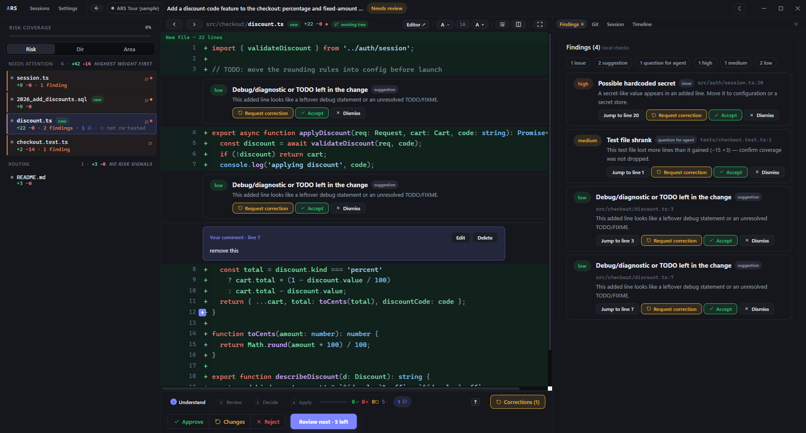
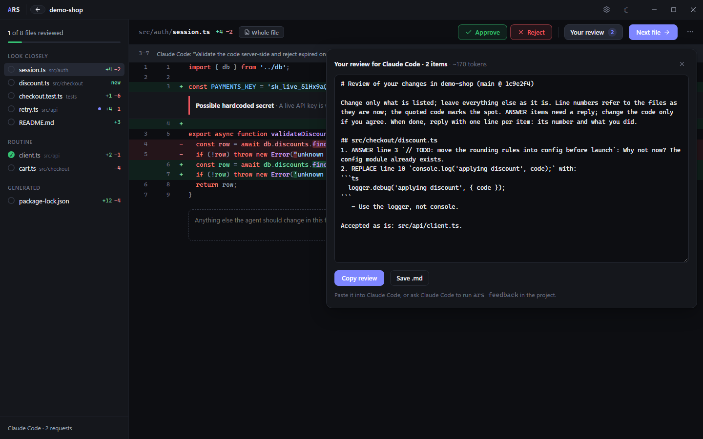
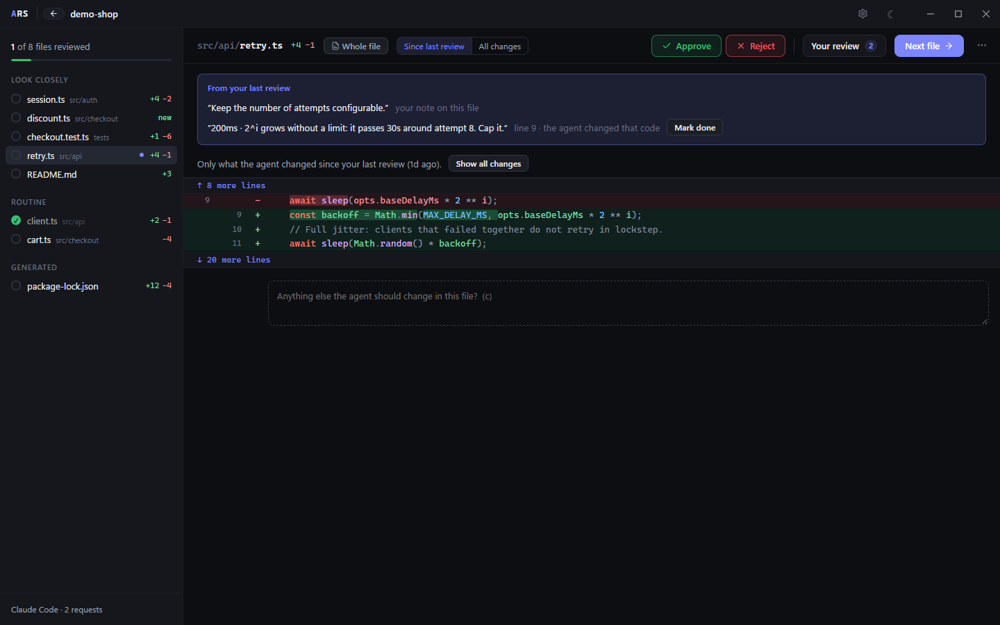

# Agent Review Studio

[](https://github.com/ldgweb/agent-review-studio/actions/workflows/ci.yml)
[](LICENSE.md)


A desktop app for reviewing what changed in your project before you commit, with the reason for each change. It reads the transcripts your coding agents already save, so above a change you see the request it came from and what the agent said before making it. You decide what to keep, and your decisions become a review the agent can act on.

**Beta for Windows, macOS and Linux · React + TypeScript + Tauri/Rust · no account, no cloud, no network**



> I work on this in my spare time. Issues and pull requests are welcome, but I can't promise quick replies.

## Why

I wanted an easy way to review the code an agent has just changed in my current work session, and an equally easy way to tell it which parts are fine, which ones to change, or simply to ask why it made a change.

A diff alone doesn't get you there. It shows you *what* changed, not *why*. So Agent Review Studio starts from Git, like your editor does: the review is everything uncommitted in the project, whoever or whatever changed it, including what an agent did through a shell command or a script. Then it reads the agents' transcripts to explain each change. You decide change by change, comment on the exact lines or write the code you want instead, and **Copy review** gives the agent all of it in one text. The next time, you only look at what changed since.

It never touches your code. Even a rejection is an instruction for the agent, not an edit by the app.

## Quick start

1. Download the latest build for your system from [Releases](https://github.com/ldgweb/agent-review-studio/releases), or [build it from source](#build-from-source).
2. Start the app and click **Try the sample tour**. It sets up a separate sandbox repository with two sample sessions, so you can try everything without touching your own projects.
3. Then use it with your own agent. Claude Code, Codex, Cursor and VS Code Copilot are picked up from their default locations, with no setup ([details](#where-sessions-come-from)).
4. While you work, run `ars .` in the project folder (any subfolder works). The app opens, or comes to the front, on that project's review. On Windows and macOS, `ars` needs one step to be on your `PATH`; see [Install](#install).

## The everyday loop

```text
ars .           # the agent just finished: open what it changed
a / r           # approve or reject the file; c writes a note about it
⇧A ⇧R  ⇧C       # approve, reject or comment on one change; [ and ] move between changes
Copy review     # copy it for the agent: every verdict becomes an instruction
```

Paste it into the agent's next prompt. Or let the agent fetch it: ask it to run `ars feedback` in the project, and it gets the same text straight in its session. In Claude Code you can make it a command once: save a file `~/.claude/commands/review.md` that says *Run `ars feedback` in this project and carry out every numbered item; then reply with one line per item.* Then type `/review`.

The review is written for the agent to act on with as few tokens as possible: one numbered item per thing to do, grouped by file. Each item starts with a verb and points at the line by its number and the quoted code. Code is spelled out only where the agent can't know it: what to put back, or what you want instead.

````text
# Review of your changes in shop (main @ 3f2a9c1)

Change only what is listed; leave everything else as it is. Line numbers refer to the files as they are now; the quoted code marks the spot. ANSWER items need a reply; change the code only if you agree. When done, reply with one line per item: its number and what you did.

## src/cart.ts
1. CHANGE line 12 `console.log(total)`: drop the log
2. REPLACE line 30 `const limit = 10` with:
```ts
const limit = MAX_ITEMS
```
3. UNDO lines 50–51 `retryAll()`: remove the lines you added.
4. ANSWER line 64 `cache.clear()`: why not reuse the store?

## src/legacy.ts
5. RESTORE this file you deleted: `git checkout HEAD -- src/legacy.ts`

Accepted as is: src/api.ts, docs/cart.md.
````



The verbs are CHANGE, REPLACE and REMOVE (from your comments and suggested code), ANSWER (a comment that ends with a question mark), UNDO, DELETE and RESTORE (from rejections) and FIX (a hint you pass on). Comments from your last review that the agent left untouched come back, marked as still open.

When the agent is done, run `ars .` again. Changed files open on **Since last review**: the diff of just what the agent did after your review, with your earlier comments above the file. Every verdict on code that didn't change is still there. When everything is approved and there is nothing left to ask, **Finish review** gives you the commit commands to copy, or a short note that asks the agent to commit.



## How a review works

- **What's in it:** every uncommitted change of the Git repository, staged or not, plus new files.
- **The why:** above each block, the agent's words before the edit. Click them for the change step by step: your request, each edit that wrote its lines and what the agent ran right after (the first test run, commands and errors that name the file). A block that no recorded edit explains says so, with the command that named the file when there was one.
- **Read less:** moved code is linked to where it came from; whitespace-only changes and generated files (lockfiles, minified bundles, what `.gitattributes` marks `linguist-generated` or `-diff`) are folded; the same change repeated in many places can be approved once. The file list puts first what deserves a closer look.
- **A diff that reads like your editor:** syntax colors from the whole file, every changed word marked, unified or side by side, context that expands from the file. **Whole file** (`f`) shows the entire file with the changes marked. Rest the mouse on a function or class name to see its definition, found by name in the project's files of the same language. Your editor (VS Code, Cursor or Windsurf) is one click away, and right-clicking a file shows it in the file manager or copies its path.
- **Hints** under the code point at possible hardcoded secrets, leftover debug code or TODOs, test files that shrank, large single-file changes, files edited after the last passing test run, and any regex checks you add yourself. They are fixed rules, not a security assessment.
- **Decide:** per file (`a` / `r`) or per change (`⇧A` / `⇧R`, or ✓ / ✕ on the block). Comment on a line, or suggest the code you want instead, like a GitHub suggested change; a note at the end of the file covers the rest. If a change is fine, just approve it: comments are for what has to change. Press `?` to see every shortcut.
- **Copy review** (or save it as Markdown) records a round: a snapshot of every changed file, the base of "since last review". Your files are not touched; commit with your own Git tools.

Your decisions are tied to the code you saw, not to a session. A verdict on a change holds while that exact change exists, wherever it moves in the file. A verdict on a file without changes to show (a binary, a mode change) holds while its bytes and `HEAD` are the same. When something changes, only the decisions on what changed are gone.

## Try it in five minutes

The sample tour is a real Git repository in `~/.agent-review-studio/demo/demo-shop` (`%USERPROFILE%\.agent-review-studio\demo\demo-shop` on Windows) with two sample sessions. Nothing you do there touches your own projects.

1. Click **Try the sample tour** on the welcome screen (or **Settings → Data → Sample tour → Install / reset**). The review of the sandbox project opens.
2. Every block of changes has a line on top with the sample agent's reason for it. Click it to see that change step by step.
3. Look at what the review flags: `src/auth/session.ts` contains what looks like a hardcoded API key; `src/checkout/discount.ts` still has a `TODO` and a `console.log`, and it was edited **after** the last green test run.
4. Press `a` on the files that look fine and `r` on one you'd throw away. In `discount.ts`, hover a line and click the speech bubble in the margin to write a comment, say *"remove this console.log"*, or the pencil to suggest code. `Ctrl+Enter` saves.
5. The retry files come from a second sample you **already reviewed once**: `src/api/retry.ts` opens on **Since last review**, which shows only the cap the agent added after your comment.
6. When every file has a verdict, click **Copy review**. What you rejected is in it as UNDO or DELETE, for the agent to carry out. **Your review** shows it, and lets you edit it, at any point. The sandbox's files stay exactly as they were.
7. In a terminal, try `ars review` on the same project (from source, run `npm run ars -- review <folder>` in `app/`).

**Install / reset** in Settings puts the tour back to the start.

## Where sessions come from

The app only reads files the agents already write on your machine. These are the default locations; you can change any of them under **Settings → Session sources**, which also shows how many sessions each source found.

| Agent | Default location | The why |
| --- | --- | --- |
| Claude Code | `~/.claude/projects` | line by line |
| Codex | `~/.codex/sessions` | line by line |
| Cursor | Cursor's `User/globalStorage` folder (`%APPDATA%\Cursor\…` on Windows, `~/Library/Application Support/Cursor/…` on macOS, `~/.config/Cursor/…` on Linux) | per file |
| VS Code Copilot | VS Code's `User/workspaceStorage` folder | per file |
| Any agent or CI | `ars/v1` JSON files in `~/.agent-review-studio/sessions` (see the [example](fixtures/custom/basic.json) and the [parser](app/src-tauri/src/core/adapters/custom.rs)) | line by line |

"Line by line" means each changed block is matched against the edits recorded in the transcript, and the counts say how much matched ("8 of 10 lines"), never a score. "Per file" means the transcript tells which files a request touched, not which lines.

The app keeps its own copy of each session, so sessions stay listed even after the agent deletes its old transcripts. It reads only the open project's transcripts, only the lines added since its last read, and refreshes when files change, never on a timer. Turning a source off hides its sessions, and the review says when that is why a change has no explanation.

Agents change their transcript formats from time to time. If an agent you use stops showing sessions, or shows them incomplete after an update, please open a **Transcript format changed** issue. [CONTRIBUTING.md](CONTRIBUTING.md#when-an-agent-changes-its-transcript-format) explains how adapters get updated.

## Platforms

| Platform | Status |
| --- | --- |
| Windows x64 | Supported: the system I use and test it on every day |
| macOS (Apple silicon and Intel) | Experimental: built and tested by CI, not yet tried on a real Mac |
| Linux x64 | Experimental: built and tested by CI, not yet tried on a real machine |

If you use it on macOS or Linux, I'd like to hear how it went: [issue #8](https://github.com/ldgweb/agent-review-studio/issues/8) collects what works and what doesn't.

## Install

Download the package for your system from [GitHub Releases](https://github.com/ldgweb/agent-review-studio/releases), or [build from source](#build-from-source). Every file can be checked against `SHA256SUMS.txt` in the release. Builds aren't signed yet, so your system may warn about an unknown developer. There's no auto-update: download new versions by hand.

### Windows

- **Installer:** `agent-review-studio_<version>_x64-setup.exe` installs the desktop app and the CLI for the current user. If Windows says "Windows protected your PC", click **More info**, then **Run anyway**.
- **Portable:** extract the ZIP and run `agent-review-studio.exe`, or `ars.exe --help` in a terminal.
- `ars .` starts the `agent-review-studio.exe` next to it. The installer doesn't change `PATH`; to run `ars` from any terminal, add the install folder to your user `PATH` once (PowerShell, then open a new terminal):

  ```powershell
  [Environment]::SetEnvironmentVariable('Path', [Environment]::GetEnvironmentVariable('Path', 'User') + ";$env:LOCALAPPDATA\Agent Review Studio", 'User')
  ```

  For the portable build, use the folder you extracted it to.
- **Requirements:** Windows x64, the Microsoft Edge WebView2 Runtime, and Git on `PATH`.

### macOS

- Open `agent-review-studio_<version>_universal.dmg` and drag the app to Applications. It runs on Apple silicon and Intel Macs.
- The app isn't signed by Apple. The first time, allow it in **System Settings → Privacy & Security**, or run:

  ```sh
  xattr -dr com.apple.quarantine "/Applications/Agent Review Studio.app"
  ```

- The CLI is inside the app. To run `ars` from any terminal, link it once:

  ```sh
  sudo ln -sf "/Applications/Agent Review Studio.app/Contents/MacOS/ars" /usr/local/bin/ars
  ```

- **Requirements:** macOS 10.15 or later, and Git (`xcode-select --install` installs it).

### Linux

- **Debian, Ubuntu:** `sudo apt install ./agent-review-studio_<version>_amd64.deb`
- **Fedora, openSUSE:** `sudo dnf install ./agent-review-studio-<version>-1.x86_64.rpm` (or `zypper install`)
- Both packages put `agent-review-studio` and `ars` in `/usr/bin`, so `ars .` works right away.
- **AppImage:** make it executable (`chmod +x`) and run it. It holds the app only: for the `ars` CLI, use the deb or rpm package.
- **Requirements:** x64, WebKitGTK 4.1 (the packages install it), and Git.

### Where things are kept

The session index, decisions, settings and the file snapshots of each review round go to `~/.agent-review-studio` (`%USERPROFILE%\.agent-review-studio` on Windows), for the portable build too. Window position and the web view's cache live in a `com.agentreviewstudio.desktop` folder in the system's app data.

## CLI

```text
ars .                       # open this project's review in the app
ars open [dir]              # the same, for another folder
ars list                    # recent agent sessions
ars review [dir]            # the review in the terminal: who wrote what, your verdicts, hints, comments
ars feedback [dir]          # for the agent: print the review as instructions, start the next round
```

`feedback` prints exactly what **Copy review** copies in the app (your edited text, if you edited it) and records the round the same way. When you have not asked for anything yet, it says so and records nothing. The agent needs `ars` on its `PATH` (see [Install](#install)).

`review` takes a folder of the project (the current one by default) or a session id from `ars list` (that session's project). `ars review --json` prints the whole review as JSON; it holds diffs and transcript excerpts, so don't share it. `ars --help` lists all the flags.

## Data and trust

The app only reads your projects: Git runs read-only, and nothing in a work tree is ever written, reverted or committed by it. It never uses the network: no AI service, no telemetry, no update check. Links open in your browser only when you click them.

Transcripts, the app's SQLite database (with the file snapshots of each review round), the review text and `ars review --json` output can contain private code or credentials. Keep `~/.agent-review-studio`, agent session folders and environment files out of public repositories.

Only use projects and transcripts you trust. The app runs with your user permissions, and Git configuration, hooks and filters can run code. See [SECURITY.md](SECURITY.md), which also explains how to report a vulnerability.

## Build from source

You'll need Node.js 22.12 or newer, Git, and Rust via rustup (the version pinned in `app/src-tauri/rust-toolchain.toml` installs itself). Then, for your system:

- **Windows:** the MSVC toolchain, Visual Studio Build Tools with **Desktop development with C++** and a Windows SDK, and WebView2.
- **macOS:** the Xcode Command Line Tools (`xcode-select --install`).
- **Linux (Debian, Ubuntu):** `sudo apt install libwebkit2gtk-4.1-dev libgtk-3-dev librsvg2-dev libsoup-3.0-dev build-essential pkg-config`. Other distributions: see [Tauri's prerequisites](https://v2.tauri.app/start/prerequisites/).

Restart the terminal after installing the toolchains. Then, from `app/`:

```powershell
npm ci
npm run tauri:dev
```

`npm run dev` on its own serves only the frontend; the native API needs the Tauri desktop shell. `npm run tauri:build` builds an installer, with the `ars` CLI bundled in. To build just the executables, without an installer:

```powershell
npm run tauri -- build --no-bundle --ci -- --locked
```

The output goes to `app/src-tauri/target/release/`: `agent-review-studio` and `ars` (with `.exe` on Windows) and, for bundled builds, the packages under `bundle/`.

| Path | Contents |
| --- | --- |
| `app/src/` | React + TypeScript UI |
| `app/src-tauri/src/core/` | Shared Rust core: adapters, normalization, Git, storage |
| `app/src-tauri/src/cli/`, `app/src-tauri/src/bin/ars.rs` | The `ars` command-line interface |
| `fixtures/` | Synthetic transcripts and their expected normalized output |

### Checks

From `app/`:

```powershell
npm test
npm run build
npm audit
npm run audit:rust
cargo fmt --check --manifest-path src-tauri/Cargo.toml
cargo clippy --release --locked --all-targets --manifest-path src-tauri/Cargo.toml -- -D warnings
cargo test --release --locked --manifest-path src-tauri/Cargo.toml
```

The Rust audit looks up every registry package in `Cargo.lock` on OSV. It fails only on a vulnerability in a package a release build ships (Windows, macOS or Linux), unless `app/scripts/audit-allowlist.json` says why it doesn't affect the app. Informational advisories (unmaintained, unsound) are listed but don't fail it. Both audits need internet access. Three Rust smoke tests are ignored by default because they read or change real user data; the normal tests only use synthetic fixtures and temporary repositories.

## Contributing

See [CONTRIBUTING.md](CONTRIBUTING.md). Bug reports that come with a synthetic transcript, or that use the built-in sample project, are the easiest for me to act on. Please never attach real transcripts or databases to an issue.

## License

[MIT](LICENSE.md) © 2026 Lucio (ldgweb)
